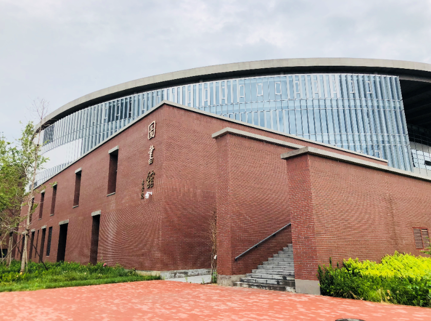
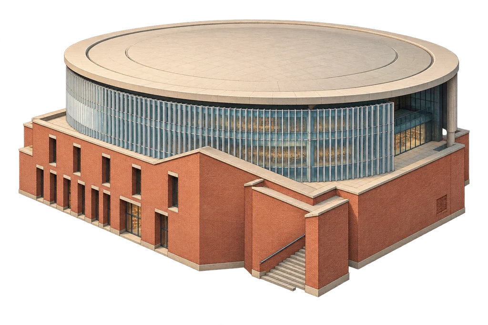

# 链上邮园二期：维护与验收

二期继续使用原 PostCampus 合约及 API。地图采用 PixiJS 8、固定斜俯视角建筑图和独立地面／阴影／灯光／等级装饰层；它是融合西土城与沙河地标的艺术化校园，并非实测地理地图或可旋转三维模型。

截图、录屏、测试结果及性能限制见 [本地验收记录](validation.md)。

## 实景参考与原创素材

参考照片保存于本目录 `references/`，只用于建筑对照，不随网站页面加载。网站使用的原创 RGBA 素材位于 `apps/web/public/campus/v2/`，由内置 imagegen 生成，随后保持 alpha 压缩为 WebP。提示词见 [prompts.md](prompts.md)。

| 地标 | 官方实景参考 | 原创游戏素材 | 保留的识别特征 |
| --- | --- | --- | --- |
| 西土城主楼 |  |  | 浅色高层塔楼、规则窗格、平屋顶、两侧低翼楼及入口台阶 |
| 沙河图书馆 |  |  | 红砖基座、弧形玻璃上部、竖向构件和宽屋檐 |
| 大龙邮票 |  |  | 嵌入园路的水平邮票石板、龙纹浅浮雕及邮票边框；修正一期立式雕像画法 |

来源：

- [北邮本科招生网：西土城路校区](https://zsb.bupt.edu.cn/info/1044/1693.htm)。主楼原图：`https://zsb.bupt.edu.cn/__local/2/53/E2/033060C6A57C92D118CEA563904_BACA3471_CFA6C.jpg?e=.jpg`；邮票原图：`https://zsb.bupt.edu.cn/__local/3/C4/D1/3AA5BD6EA379FC55682E2AE7330_073C75BD_184C70.jpg?e=.jpg`。
- [北邮本科招生网：现代化的校园设施](https://zsb.bupt.edu.cn/info/1021/1628.htm)。图书馆参考图来自该官方站点：`https://zsb.bupt.edu.cn/__local/0/2F/99/65769E684F8343E79175522FDC5_6AFAC660_137511.png`。
- [北邮新闻网：文化景观](https://news.bupt.edu.cn/info/1020/20019.htm)，说明大龙邮票为园路大理石雕刻，并列出时光广场等文化地标。

时光广场采用钟塔与水景的艺术化表现，实验室是社区主题原创设计，页面中明确标注。人物只作氛围装饰。

## 场景与资源

`campus-scene.ts` 集中定义五个地标的坐标、尺寸、点击位置、等级与景观映射。建筑主体不因等级改变轮廓；Lv.2 增加入口铺装，Lv.3 增加绿化，Lv.4 增加路灯，Lv.5 增加共建旗饰。

完成共建 1／2／3 轮分别解锁步道照明、花园、纪念装置，之后保留景观并继续显示真实完成轮数。首次加载只展示现状；在线观察到新轮次才播放反馈。

远景使用 `*-low.webp`，近景按需加载高清版本。原图 alpha 不被替换；可用 `python tools/campus-assets.py <地标名> <生成的PNG路径>` 重新导出。树木使用同一管线，实际运行只加载其 low 版本。不要把参考照片放进运行时清单。

地图入口在游戏页面按需加载，不进入首页和论坛的初始依赖。经典视图共用同一个会话与操作面板。WebGL 不可用、素材失败或上下文丢失时自动回退；不依赖更换合约或服务器环境变量。

## 会话与交易约束

- 玩家、世界、待结算收益和 gas 余额在同一个指定区块读取。成功交易后的读取区块不早于回执区块。
- `getPlayer` 已含待结算收益；资源栏不再叠加 `getPending`。升级及贡献由合约自动结算。
- 钱包确认、提交、确认后同步、成功、拒绝、取消、失败和超时分别展示。同步成功前不播放完成效果；旧交易恢复与重试不补播成功动画。
- 待确认哈希沿用一期的「链＋合约＋成员地址」存储键。提价替换跟踪新哈希；取消或替换为另一项操作不被记为原操作成功。
- 每次刷新、提交前与确认后同步均校验登录权限。401／403 清除会话和玩家界面；失效会话、旧请求及旧交易回调不能覆盖当前成员。
- 手机或小屏仅浏览；横屏仍识别为移动设备。UI 和交易入口同时禁止手机写操作。未登录手机可从 `/game` 打开公开静态预览。

昼夜按北京时间执行：06:00–17:00 白天，17:00–19:00 黄昏，其余夜晚。时段、经典视图选择及手动减少动态效果保存在本浏览器；系统减少动态效果优先。公开预览固定为静态示例，不读取玩家进度。隐藏页面暂停地图动画及定时链上刷新，恢复可见后同步。

## 验证命令

```bash
pnpm install --frozen-lockfile
pnpm --filter web lint
pnpm --filter web typecheck
pnpm --filter web test
pnpm --filter web build
pnpm --filter web exec playwright install chromium
CAMPUS_TEST_PRODUCTION=1 pnpm --filter web test:e2e
```

Playwright 使用模拟 API、JSON-RPC 和测试 EIP-1193 钱包，不发送公共测试网交易。测试截图、录屏、性能记录与 JSON 报告生成在 `apps/web/test-results/`，CI 上传为 `campus-browser-results` artifact。浏览器使用 SwiftShader，手机测试为触屏模拟，不代表实机手机测试。

本地整链联调：启动 `anvil --host 127.0.0.1 --port 8545`，在该本地链部署一份全新 PostCampus，然后运行：

```bash
CAMPUS_ANVIL_CONTRACT=<本地新合约地址> pnpm --filter web exec vitest run src/lib/campus-anvil.test.ts
```

该测试检查链 ID 必须为 31337，仅使用本地节点的解锁测试账户，覆盖双账户加入、时间推进、领取、升级、贡献、暂停与恢复。重复执行应重新部署一份本地合约。集成测试为本地节点的升级／贡献交易设置充足 gas，避免瞬时估算与出块时间差干扰业务回归。

## 发布、复查与回退

通过待评审 PR 交付；合并和生产发布由用户后续确认。现有 `GAME_ENABLED`、合约地址及管理员钱包保持原配置，无数据库迁移。

发布后检查 `/api/health`、`/api/game/status`、匿名配置接口的 401、登录后原有资源和建筑等级、五个地标、地图缩放、经典回退、手机浏览及退出清理。需要交易的复查由钱包保管人在钱包中确认。

若只是渲染兼容问题，可先切换经典视图；需要代码回退时使用既有部署流程回退上一个已验证的版本。两种方式均不删除链上进度。
