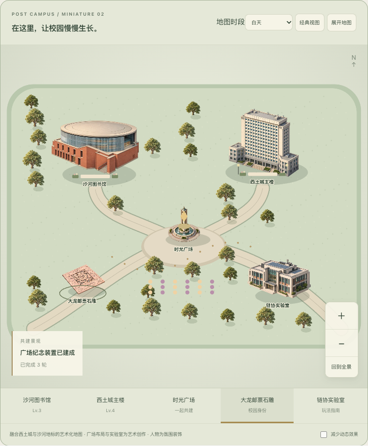
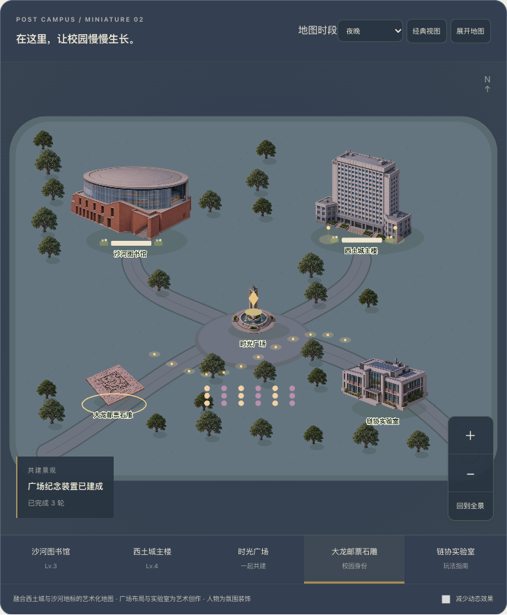
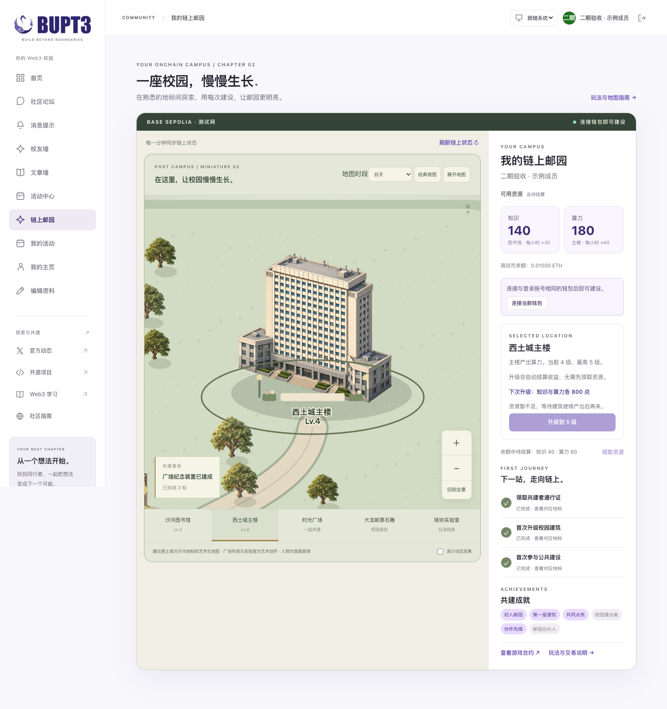
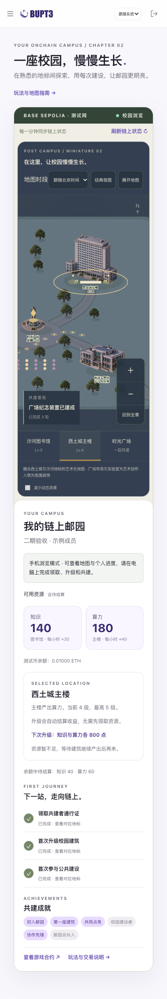

# 二期本地验收记录

日期：2026-10-18。以下页面截图使用模拟成员、模拟 RPC 和测试钱包，不代表生产成员余额；真实合约联调在本地 Anvil 进行。

## 结果

| 检查 | 结果 |
| --- | --- |
| 前端 ESLint / TypeScript | 通过 |
| Vitest 业务与交易状态 | 19 项通过；默认跳过需要独立本地链的集成测试 |
| Anvil 真实合约联调 | 单独运行 1 项通过：双账户加入、收益、领取、升级、共建、暂停与恢复 |
| Playwright 生产模式 | 13 项通过：模拟钱包成功／拒绝、换钱包、新成员、五级建筑、共建景观、暂停、地图缩放拖动、触屏、401／403、退出、经典回退 |
| 生命周期补充检查 | 通过：减少动态、模拟页面隐藏与恢复、反复进出地图、WebGL 上下文丢失 |
| API ruff / format / pytest | 通过，99 项测试 |
| Foundry format / test / build | 通过，15 项测试，含每项 256 次的模糊测试 |
| 生产依赖审计 | pnpm audit 与 pip-audit 均未发现已知漏洞 |
| Next.js 生产构建 | 通过；钱包 SDK 仍有可选依赖提示，不影响构建完成 |
| Docker / 完整 CI | 由待评审 PR 的 CI 执行并在 PR 中记录最终结果 |

## 性能与资源

环境：macOS arm64，Apple M5 Pro，48 GiB 内存，Node 22.23.2，Playwright 1.64.1 / Chromium 156，WebGL 使用 SwiftShader 软件渲染。手机测试为 390×844 的触屏浏览器模拟，不是实机手机性能结论。

- 首批低细节图片共 **301,150 字节（约 294 KiB）**，包含五个地标与树木，低于 4 MB 目标。近景才加载五个高清建筑。
- 桌面软件渲染样本约 **51.6 FPS**；手机触屏模拟约 **30.4 FPS**。真实 GPU 和实际手机帧率仍需在相应设备上复核；没有把模拟结果标成实机结果。
- 地图缩放和拖动期间没有新增链上 RPC 请求，RPC 由独立会话控制。
- 三次「微缩 → 经典 → 微缩」切换后始终只保留一个 canvas。
- 主动 GC 后 JS heap 从 **15,963,780** 字节变为 **16,074,128** 字节，增长 **110,348** 字节（约 108 KiB）。这是浏览器 JS heap 检查，不是 GPU 显存测量。
- 减少动态效果及模拟页面隐藏时 `data-running=false`；恢复可见后重新运行并同步状态。

上述数值来自本地浏览器验收样本，不构成跨设备性能保证。CI 的 JSON 报告包含该次运行的性能与生命周期附件。

## 画面与录屏

### 白天全景

### 夜间灯光

### 主楼近景与操作面板

### 手机浏览

[地图缩放、拖动、经典切换与回退录屏](screenshots/interactions.webm)。完整测试录屏、失败 trace 和 JSON 报告由 CI 作为 `campus-browser-results` artifact 保存 7 天。

实景照片与原创素材对照、生成提示词和维护说明见 [README](README.md)。
